# 优享财务系统 · 安装教程

本文以宝塔 Linux 面板（Nginx）为例，给出从建站到上线的完整安装步骤。

> 文中插图分两类：**宝塔面板示意图**（按宝塔 9.x 菜单与字段绘制）用于说明每一步在面板里点哪里；**安装向导示意图**（按 `install/install.php` 字段绘制）用于说明向导每步填什么。两类图均为示意图，示例数据已脱敏。

---

## 一、环境要求

| 需求名称 | 推荐配置 | 最低要求 |
| --- | --- | --- |
| 操作系统 | CentOS、Debian 或 Ubuntu | Linux（勿使用 Windows） |
| 硬件配置 | 2H4G、系统盘 40G SSD（可酌情调高） | 2H2G、系统盘 40G |
| PHP 版本 | 8.2 | 8.0 |
| PHP 扩展 | PDO、pdo_mysql、curl、openssl、mbstring、gd、json、fileinfo | pdo_mysql、curl、openssl、mbstring |
| 数据库 | MySQL 5.7 / 8.0（SQLite 亦可） | MySQL 5.7 |
| Web 服务 | Nginx（推荐）或 Apache | — |

> 注意：系统为原生 PHP 开发，站点运行目录即项目根目录，**无需设置 `/public` 运行目录，也无需 ionCube、无需 Opcache**。

---

## 二、安装宝塔

参考[宝塔官方安装脚本](https://www.bt.cn/bbs/thread-19376-1-1.html)，用 SSH 登录服务器后执行安装脚本，安装完成后会输出面板地址、账号与初始密码。

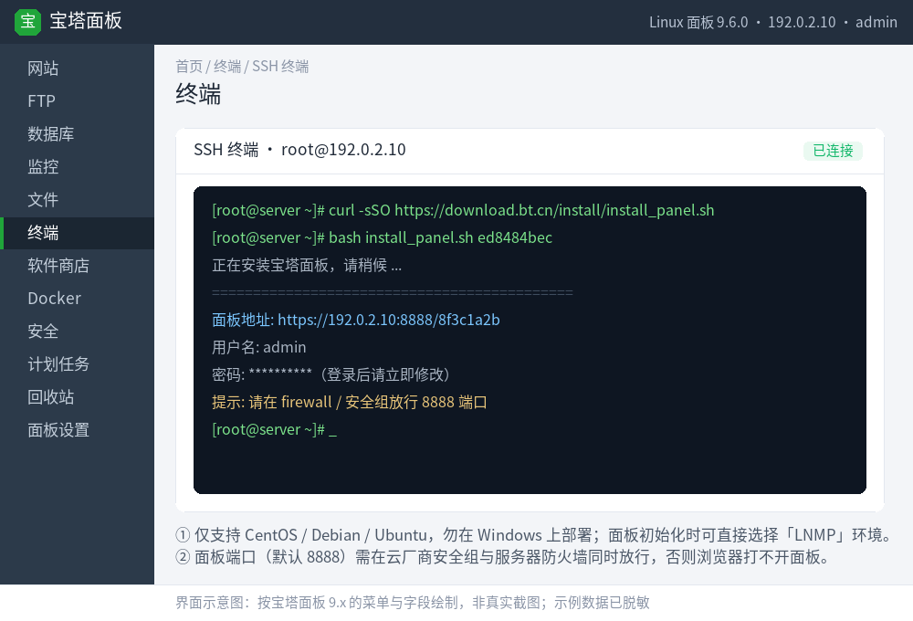

> 面板端口（默认 `8888`）需在云厂商安全组与服务器防火墙同时放行；登录后第一件事是改掉初始密码。

---

## 三、安装 LNMP 运行环境

登录宝塔 →「软件商店」，安装 **Nginx + MySQL 5.7/8.0 + PHP 8.2**。安装完成后在「网站 → PHP 设置」确认 PHP 8.2 已启用。

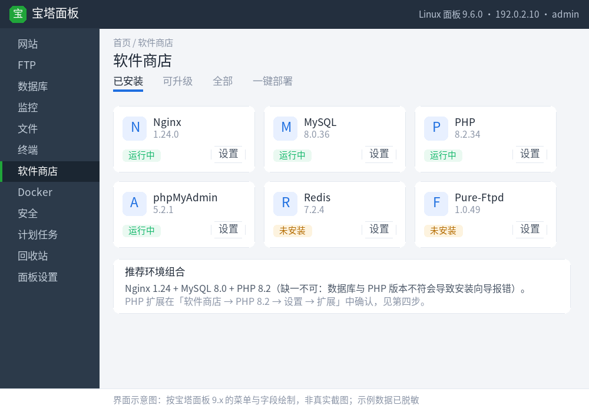

---

## 四、为 PHP 安装相关扩展

「软件商店 → 已安装」，点击 PHP 8.2 右侧的「设置 → 扩展」，确认以下扩展已开启：

`pdo_mysql`、`curl`、`openssl`、`mbstring`、`gd`、`json`、`fileinfo`

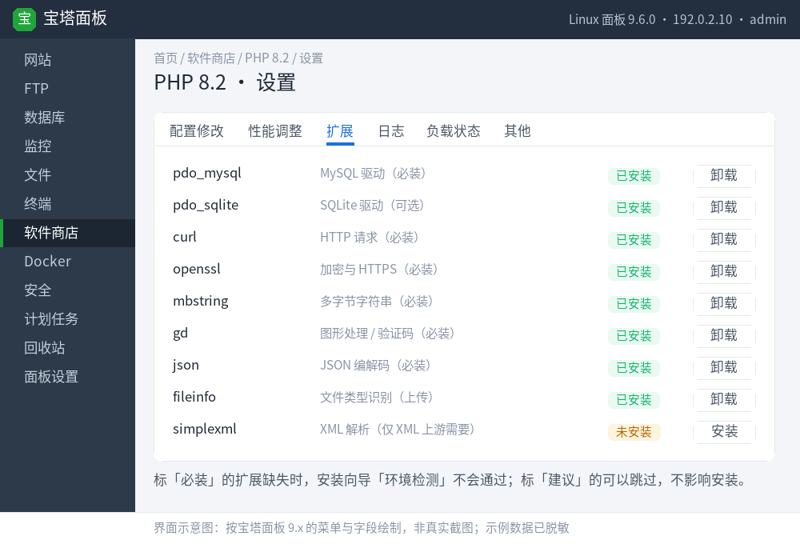

---

## 五、获取并上传安装包

1. 获取优享财务系统安装包（发行包或 Git 仓库）。
2. 上传压缩包到服务器 `/www/wwwroot/` 目录。
3. 解压到站点根目录，确保 `index.php`、`includes/`、`admin/`、`install/` 直接位于站点根目录下，**不要多套一层文件夹**。

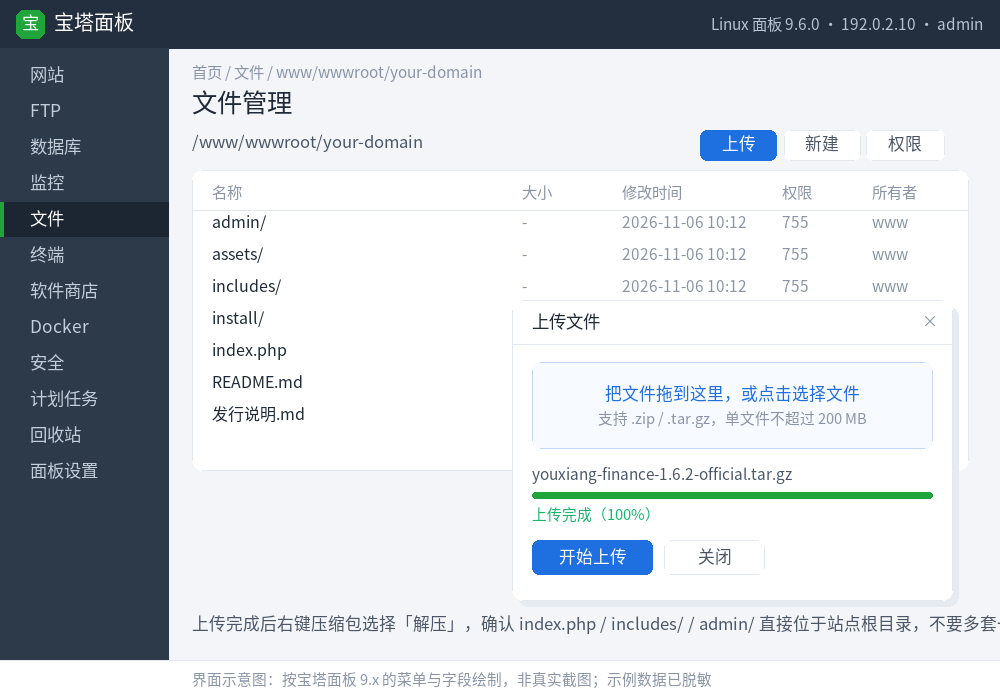

```bash
cd /www/wwwroot/your-domain
unzip youxiang-finance.zip -d ./
ls   # 应能看到 index.php install includes admin user store
```

---

## 六、添加站点

1. 面板 →「网站」→「添加站点」。
2. 填写域名，PHP 版本选 **8.2**；FTP、数据库可暂不创建（数据库下一步单独建）。
3. 站点目录填写上一步的代码目录。

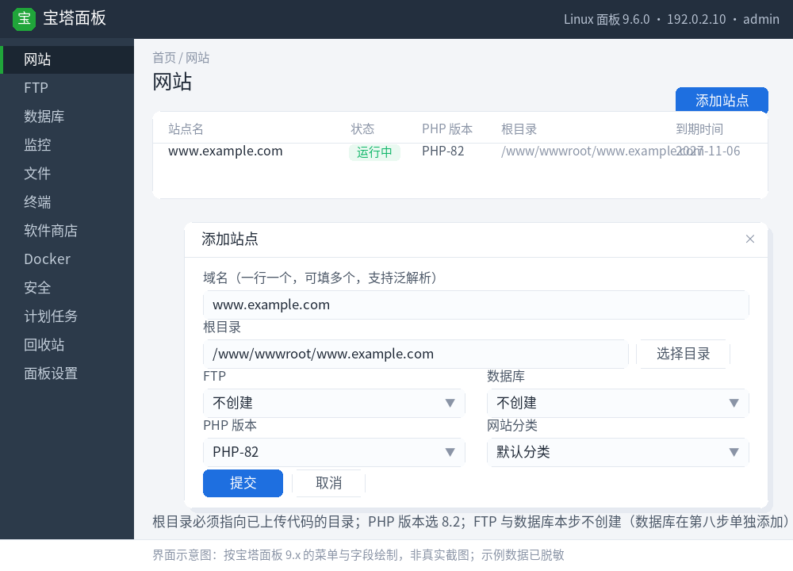

---

## 七、目录权限设置

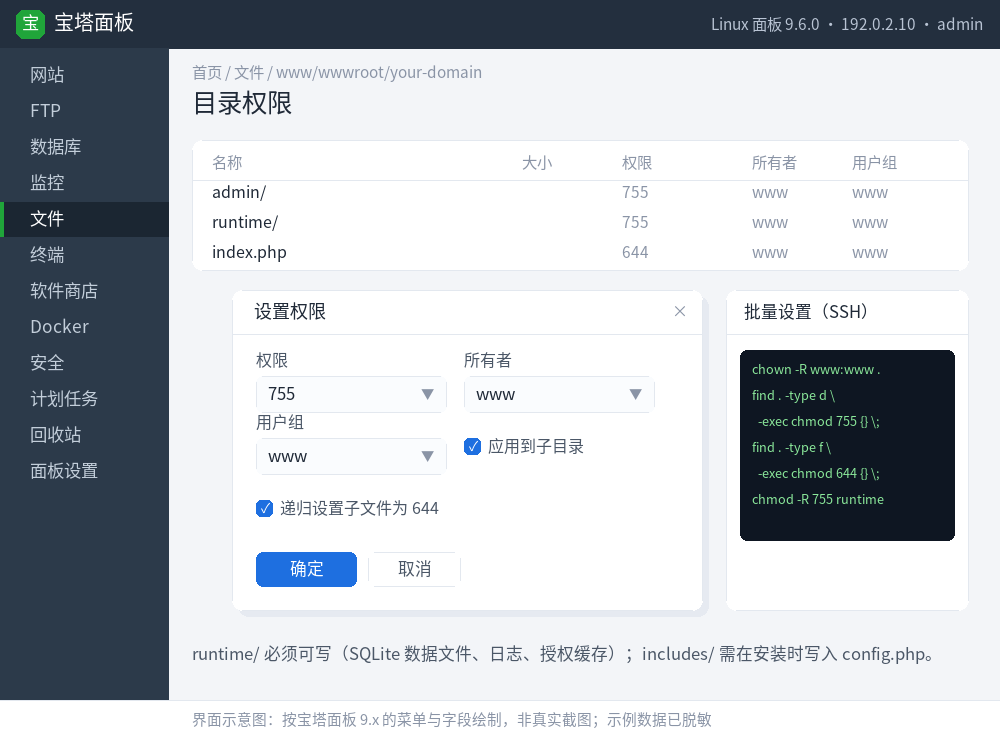

```bash
cd /www/wwwroot/your-domain
chown -R www:www .
find . -type d -exec chmod 755 {} \;
find . -type f -exec chmod 644 {} \;
chmod -R 755 runtime
```

> `runtime/` 需要写权限（SQLite 数据文件、日志、授权缓存）。

---

## 八、创建数据库

面板 →「数据库」→「添加数据库」：

- 数据库名：如 `youxiang_finance`
- 用户名 / 密码：由面板生成，请妥善保管
- 访问权限：**本地服务器**（不要开放所有人）

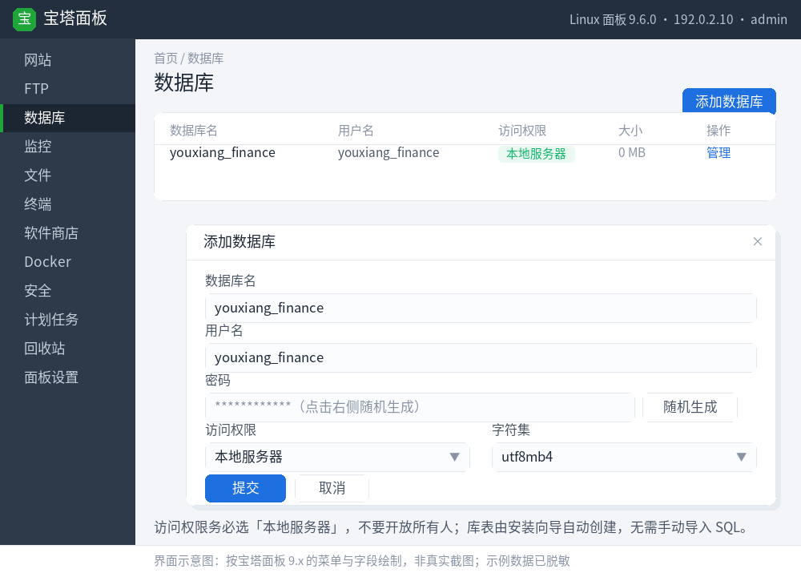

数据库**无需手动导入 SQL**，安装向导会自动建表并写入默认数据。

---

## 九、伪静态与重写规则

系统使用 `index.php?s=xxx` 方式路由，宝塔站点模板默认已包含 `try_files`，**一般无需额外伪静态**。若你使用 ThinkPHP 风格路由，可在「网站 → 设置 → 伪静态」填写：

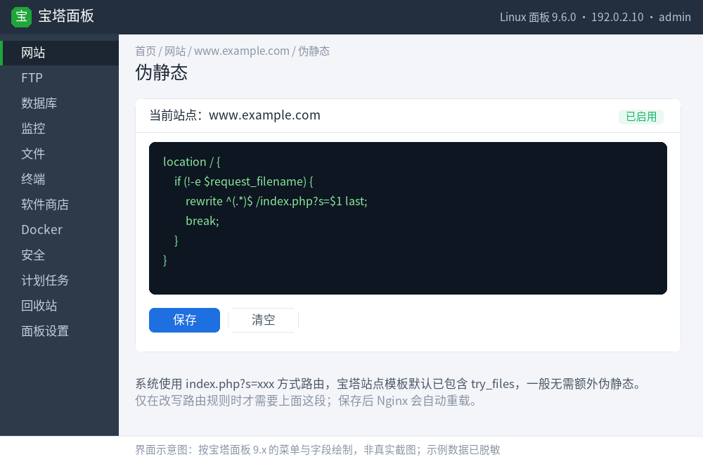

```nginx
location / {
    if (!-e $request_filename) {
        rewrite ^(.*)$ /index.php?s=$1 last;
        break;
    }
}
```

---

## 十、执行安装

浏览器访问（需先确保安装目录可访问，见下方注意事项）：

```
https://your-domain/install/install.php
```

若站点配置里已封闭安装目录，先在「网站 → 设置 → 配置文件」中临时注释掉 `/install/` 那条规则并保存：

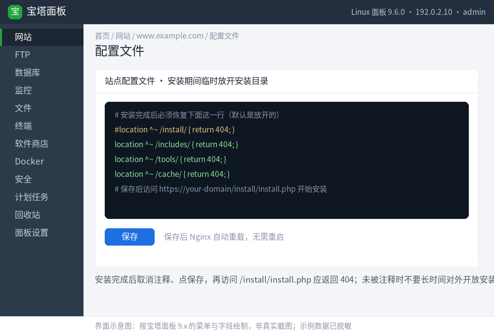

向导共 5 步：**许可协议 → 环境检测 → 数据库与站点 → 创始人信息 → 安装完成**，顶部步骤条会显示当前进度，未完成的步骤不能跳步进入。

1. **许可协议**：阅读《软件使用协议与免责声明》，勾选「我已阅读并同意」后点「同意并继续」。

2. **环境检测**：自动检查操作系统、PHP 版本（≥ 8.0）、PDO 扩展、常用 PHP 模块与目录权限。
   - 标「必检」的项目未通过时**不能**进入下一步；
   - 标「建议」的项目（如 `simplexml`，仅对接 XML 上游时需要）不影响安装；
   - 修改服务器配置后点「重新检测」刷新结果，无需重开向导。

   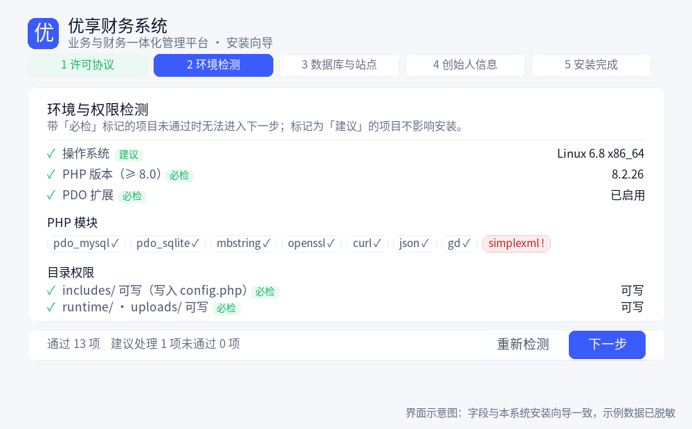

3. **数据库与站点**：本步只做连接测试，点「下一步」后才写入数据库配置。
   - **站点信息**：系统名称、网站域名（授权码绑定用，**不要**带协议与路径）、后台路径（默认 `admin`，可自定义以降低扫描风险）、初始版本、是否开启调试模式；
   - **数据库**：驱动选 **MySQL**（推荐生产使用）或 **SQLite**（单机小规模，数据文件默认 `runtime/youxiang.db`）；
   - 表前缀默认 `yx_`，一般保持不变；
   - MySQL 填主机 `127.0.0.1`、端口 `3306`、库名、账号、密码；若面板账号无建库权限，先手动建库，**不要**勾选「库不存在时自动创建」。

   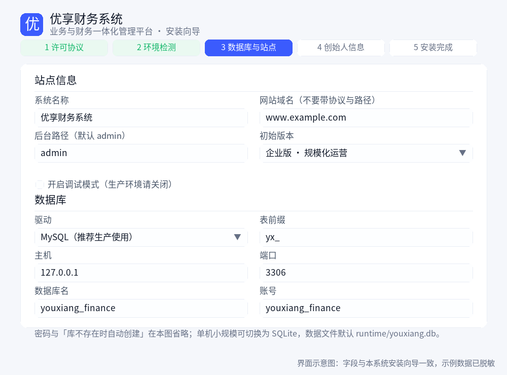

   > 自定义后台路径会生成同名目录（内部为指向 `admin/` 的符号链接），直接访问 `admin/` 将返回 404；需要服务器允许创建符号链接。

4. **创始人信息与授权码**：填写管理员账号（3-32 位字母、数字、下划线、点或连字符）、密码（≥ 8 位，需重复一次）与邮箱（必填且需格式有效）；授权码**选填**。
   - 授权码格式为 4 组、每组 4 位十六进制（如 `8F41-CB20-2D8B-9A76`），与第 3 步填写的域名绑定；
   - 点「检测序列码」会实时校验并给出结论：**通过**可继续；**不匹配**会阻止安装（需核对授权码或域名）；**本地无记录**则提示「待官方核验」，仍可继续；
   - 不填授权码也能装完，系统以「未授权」状态运行，之后可在后台「授权中心」补录。

   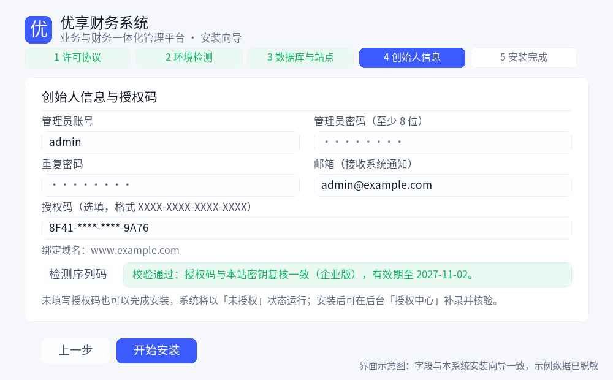

5. **安装完成**：显示入口地址与数据库类型，**5 秒后自动跳转到后台登录页**，也可点「立即进入后台」。

   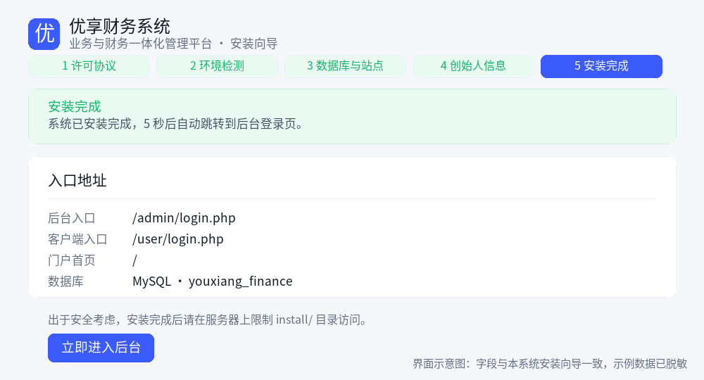

安装完成后的入口：

| 入口 | 地址 |
| --- | --- |
| 后台（默认路径） | `/admin/login.php` |
| 客户端 | `/user/login.php` |
| 门户首页 | `/` |

> 若自定义了后台路径（例如 `manage`），实际入口为 `/manage/login.php`。
> 重复运行向导默认不再写入配置；确需重跑（不会清空数据，但会覆盖站点名称、域名、后台路径等设置）请在地址后追加 `?force=1`。

---

## 十一、安装后必须做的安全设置

### 1. 关闭安装目录访问

宝塔站点配置模板默认已包含：

```nginx
location ^~ /install/ { return 404; }
location ^~ /includes/ { return 404; }
location ^~ /tools/ { return 404; }
location ^~ /docs/ { return 404; }
location ^~ /cache/ { return 404; }
```

如果安装时需要临时放开，注释掉 `/install/` 那一行再做安装，装完务必恢复。验证方式：访问 `/install/install.php` 应返回 404。

### 2. 确认生产配置

`includes/config.php` 中 `debug` 为 `false`，文件权限 `644`、属主 `www:www`。

### 3. 开启 HTTPS

网站 →「SSL」申请证书并开启强制 HTTPS。

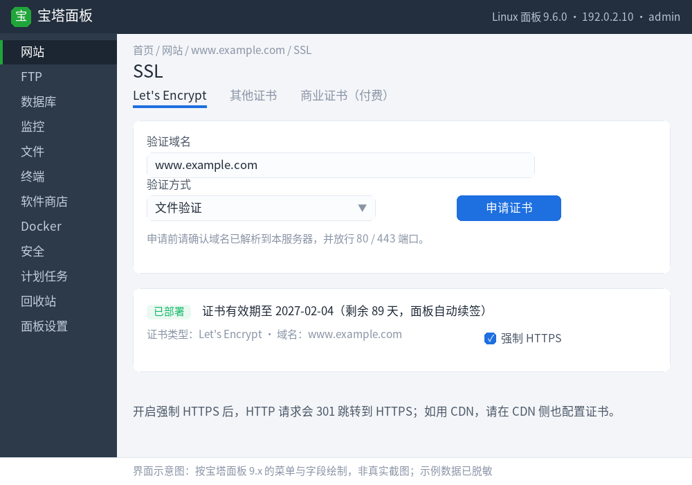

---

## 十二、配置计划任务

面板 →「计划任务」→ 创建 Shell 脚本任务，周期每 5–10 分钟：

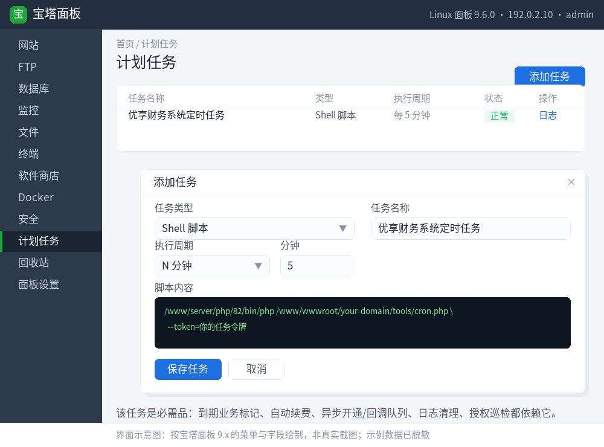

```bash
/www/server/php/82/bin/php /www/wwwroot/your-domain/tools/cron.php --token=你的任务令牌
```

令牌在后台「系统设置 → 定时任务」生成。该任务是**必需品**：到期业务标记、自动续费、异步开通/回调队列、日志清理、授权巡检都依赖它，未配置会导致付款后业务长期停留在「待开通」。

---

## 十三、安装完成检查

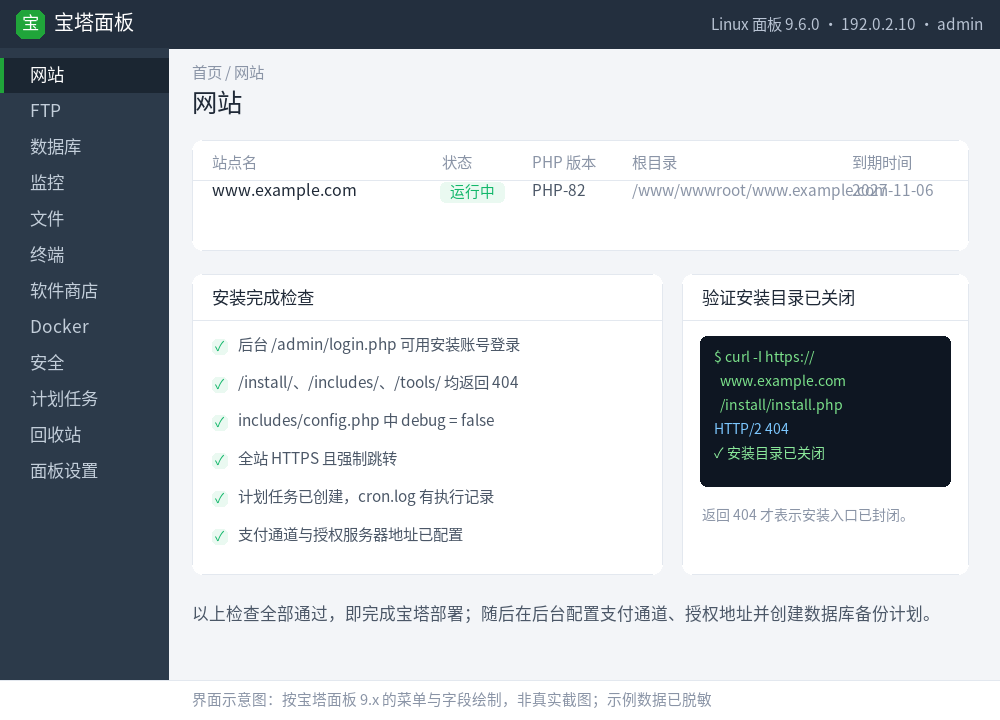

- [ ] 访问 `/admin/login.php` 能用安装时创建的账号登录
- [ ] `/install/install.php`、`/includes/`、`/tools/` 均返回 404
- [ ] `includes/config.php` 中 `debug = false`
- [ ] 全站 HTTPS 且强制跳转
- [ ] 计划任务已创建，`runtime/cron.log` 有执行记录
- [ ] 后台已配置支付通道与授权服务器地址
- [ ] 已在面板「计划任务」中添加数据库定期备份

---

## 十四、常见问题

**Q：安装时提示数据库连接失败？**
A：核对库名/账号/密码；确认已在宝塔把该库的访问权限设为「本地服务器」；MySQL 端口是否为 3306。

**Q：后台某些菜单点进去跳回仪表盘？**
A：该功能超出当前版本能力。到「版本与模块」切换版本，或查看功能对照表中「当前可用」列。

**Q：页面一直显示「域名未在官方授权」？**
A：这是正常的未授权提示。可在「授权中心」新增本站域名的授权记录，或把「官方授权服务器地址」指向你的授权中心。如需未授权时限制功能，开启「系统设置 → 未授权时强制收敛为普惠版」。

**Q：改成 MySQL 后想换回 SQLite？**
A：重新运行安装向导，驱动选 SQLite 并指定数据文件路径即可（原 MySQL 数据不会被删除）。

**Q：充值后余额没变？**
A：检查支付通道是否配置、网关回调是否可达（`api/pay_notify.php`）、回调验签是否通过（后台「操作日志」中有 `pay.notify_reject` 记录即为验签失败）。未配置通道时请用后台「订单管理 → 线下收款」人工入账。
