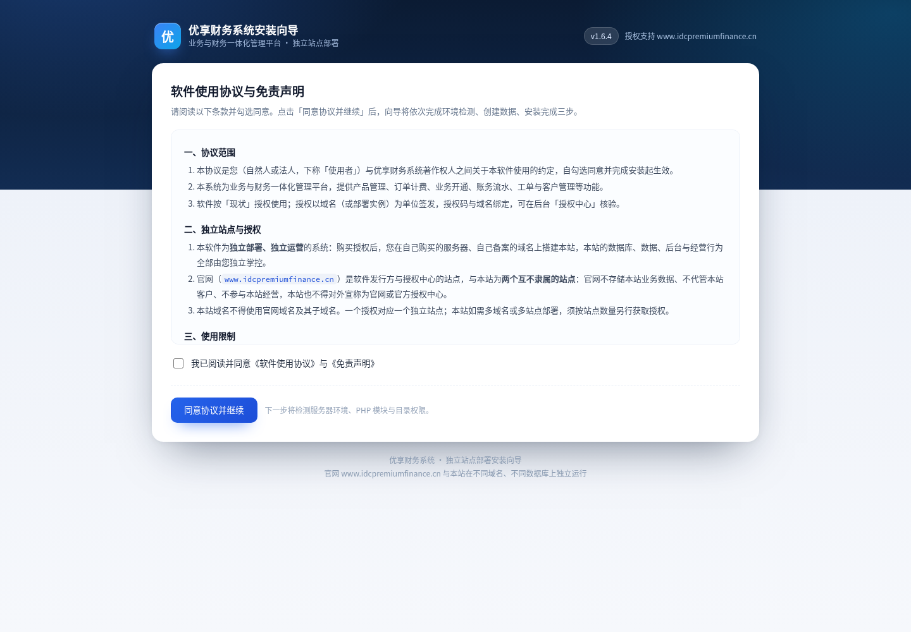
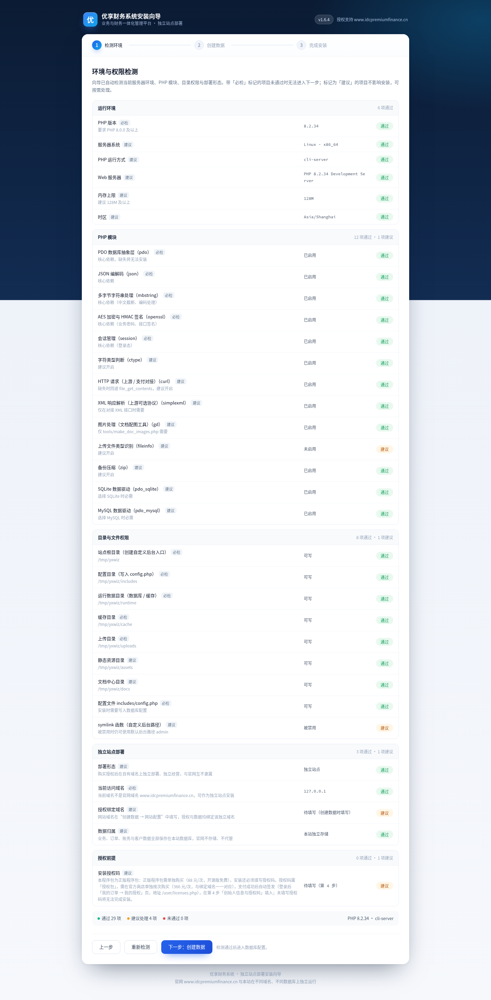
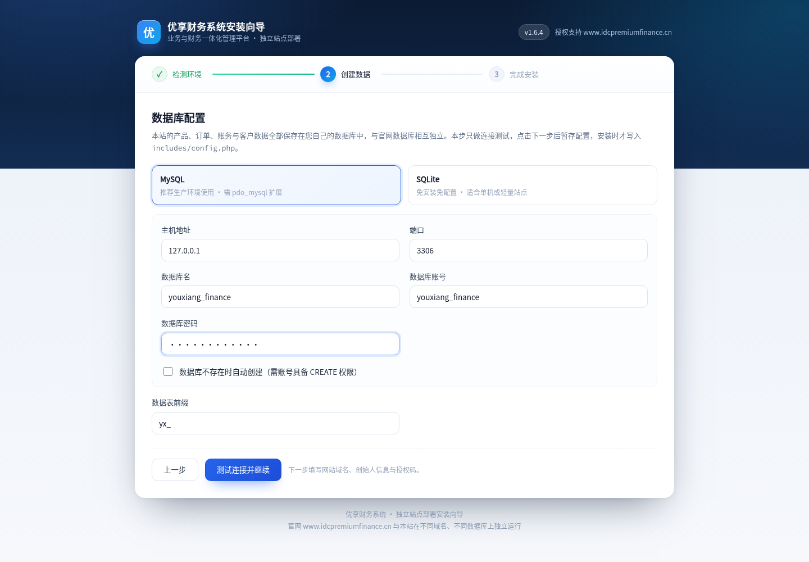
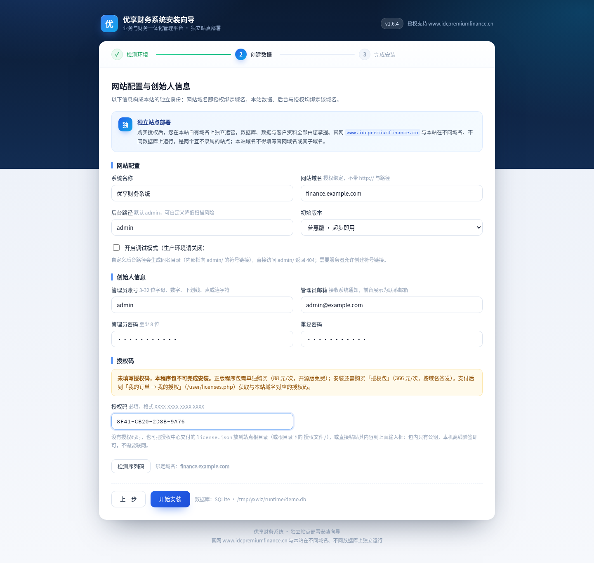
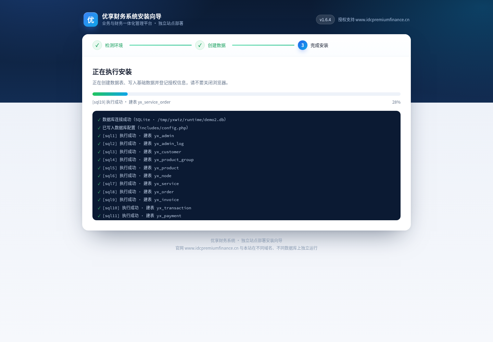
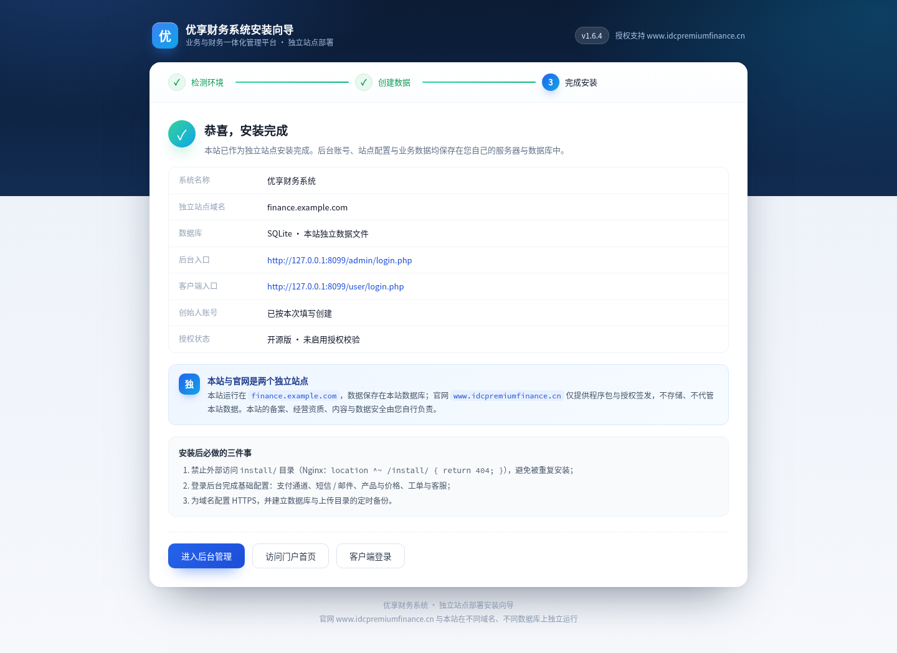

# 优享财务系统 · 安装教程

本文以**宝塔 Linux 面板 13.x + Nginx + PHP 8.2** 为例，覆盖从添加站点到安装完成、安全加固的完整流程。

> **关于插图**：宝塔面板相关插图为按面板菜单绘制的操作示意图（示例数据已脱敏）；安装向导相关插图均为当前版本向导的**实际运行截图**，字段、按钮与提示文字与您安装时看到的一致。

---

## 一、安装前须知

### 1. 独立站点原则

优享财务系统是**独立部署、独立运营**的系统，不是官网的子站或多租户实例：

- 本站必须使用**您自己的域名**（已备案并解析到本站服务器）；
- 本站必须使用**独立的数据库与数据文件**；
- 本站的业务、订单、账务、客户数据全部保存在本站，官网不存储、不代管；
- 本站域名填写你自己的独立域名即可。

### 2. 授权说明

| 程序包类型 | 是否需要授权码 | 说明 |
| --- | --- | --- |
| 正版程序包 | **需要** | 程序包需单独购买；安装还需购买与本站域名对应的「安装授权包」取得授权码 |
| 开源版 | 不需要 | 不启用授权校验，安装后可直接使用基础功能 |

授权码**按域名签发**，一个授权对应一个独立站点。授权码不在程序包内，请到「我的订单 → 我的授权」获取；也可使用授权中心交付的 `license.json` 在站点根目录离线验签。

### 3. 环境要求

| 需求名称 | 推荐配置 | 最低要求 |
| --- | --- | --- |
| 操作系统 | CentOS / Debian / Ubuntu | Linux（不支持 Windows） |
| 硬件配置 | 2H4G、系统盘 40G SSD | 2H2G、系统盘 40G |
| PHP 版本 | 8.2 | 8.0 |
| PHP 扩展 | pdo_mysql、pdo_sqlite、curl、openssl、mbstring、gd、json、fileinfo | pdo_mysql（或 pdo_sqlite）、curl、openssl、mbstring |
| 数据库 | MySQL 5.7 / 8.0（SQLite 亦可） | MySQL 5.7 |
| Web 服务 | Nginx（推荐）或 Apache | — |

> 本系统为原生 PHP 开发，站点运行目录即项目根目录，**无需设置 `/public` 运行目录，无需 ionCube，也无需 Opcache**。

---

## 二、安装宝塔面板

用 SSH 登录服务器，执行宝塔官方安装脚本，完成后记录面板地址、账号与初始密码。


> 面板端口（默认 `8888`）需在云厂商安全组和服务器防火墙同时放行；首次登录后立即修改初始密码。

---

## 三、安装 LNMP 运行环境

登录宝塔 →「软件商店」，安装 **Nginx + MySQL 5.7/8.0 + PHP 8.2**。


安装完成后到「网站 → PHP 设置」确认 PHP 8.2 已启用，并进入「扩展」页签开启：

`pdo_mysql`、`curl`、`openssl`、`mbstring`、`gd`、`json`、`fileinfo`；若使用 SQLite，再开启 `pdo_sqlite`。


---

## 四、上传并解压程序包

1. 将安装包上传到 `/www/wwwroot/`；
2. 解压到站点根目录，确保 `index.php`、`includes/`、`admin/`、`install/` 直接位于根目录，**不要多套一层文件夹**。


```bash
cd /www/wwwroot/your-domain
unzip youxiang-finance.zip -d ./
ls   # 应能看到 index.php install includes admin user store
```

---

## 五、添加站点并设置权限

### 1. 添加站点

面板 →「网站」→「添加站点」：填写**您自己的独立域名**，PHP 版本选 **8.2**，站点目录指向刚解压的代码目录。FTP 与数据库可暂不创建（数据库下一步单独建）。


> 这里的域名就是后向导中要填写的「网站域名」，也是授权绑定域名。**不要填写官网域名或其子域名。**

### 2. 目录权限


```bash
cd /www/wwwroot/your-domain
chown -R www:www .
find . -type d -exec chmod 755 {} \;
find . -type f -exec chmod 644 {} \;
chmod -R 755 runtime
```

> `runtime/` 需要写权限（SQLite 数据文件、日志、授权缓存）。

---

## 六、创建数据库

面板 →「数据库」→「添加数据库」：

- 数据库名：如 `youxiang_finance`
- 用户名 / 密码：由面板生成，妥善保管
- 访问权限：**本地服务器**（不要开放给所有人）


数据库**无需手动导入 SQL**，安装向导会自动建表并写入默认数据。

> 若使用 SQLite，可跳过本步；向导默认的数据文件为 `runtime/youxiang.db`。

---

## 七、放开安装目录（如已封闭）

站点配置默认封闭了安装目录。若访问 `install/install.php` 返回 404，请到「网站 → 设置 → 配置文件」临时注释掉 `/install/` 那条规则并保存：


装完后务必恢复该规则（见「安装后安全加固」）。

---

## 八、运行安装向导

浏览器访问：

```
https://your-domain/install/install.php
```

向导共 **5 个页面**，顶部阶段条显示三个阶段：

| 阶段 | 页面 | 做什么 |
| --- | --- | --- |
| 检测环境 | ① 许可协议 | 阅读并同意协议与免责声明 |
| 检测环境 | ② 环境检测 | 检查 PHP、扩展、目录权限、部署形态与授权前提 |
| 创建数据 | ③ 数据库配置 | 选择 MySQL 或 SQLite，测试连接 |
| 创建数据 | ④ 网站配置与创始人信息 | 填写站点域名、后台路径、创始人账号与授权码 |
| 完成安装 | ⑤ 安装进度 / 完成 | 自动建表写入数据，展示入口与后续事项 |

未完成的步骤不能跳步进入；修改服务器配置后回到第 ② 页点「重新检测」即可。

### 1. 许可协议



协议包含「协议范围、独立站点与授权、使用限制、数据与运维、免责声明、其他」六部分。请重点阅读**独立站点与授权**：本站与官网是两个互不隶属的站点，本站域名不得使用官网域名及其子域名。

勾选「我已阅读并同意《软件使用协议》与《免责声明》」，点「同意协议并继续」。

### 2. 环境检测



检测分五组：**运行环境、PHP 模块、目录与文件权限、独立站点部署、授权前提**。

- 带「必检」标记的项目未通过时，**「下一步：创建数据」按钮会禁用**，需处理后点「重新检测」；
- 带「建议」标记的项目不影响安装（如 `simplexml` 仅在对接 XML 上游时需要）；
- **独立站点部署 → 当前访问域名**：如果您正通过官网域名访问向导，该项显示「未通过」，并提示改用您自己的独立站点域名。这是预期行为，官网与独立站点不能是同一站点；
- **授权前提**：正版程序包在此只提示「待填写」而不阻断，授权码在第 ④ 页填写并强制校验；开源版显示「开源版 · 不需要」。

### 3. 数据库配置



- **MySQL**（推荐生产）：主机 `127.0.0.1`、端口 `3306`、库名、账号、密码；若面板账号无建库权限，请先在宝塔建库，**不要**勾选「数据库不存在时自动创建」；
- **SQLite**：填写数据文件路径，默认 `runtime/youxiang.db`，适合单机或轻量站点；
- **数据表前缀**默认 `yx_`，一般保持不变。

本页只做**连接测试**，点「测试连接并继续」后配置暂存，安装时才写入 `includes/config.php`。

### 4. 网站配置与创始人信息



**网站配置**

| 字段 | 说明 |
| --- | --- |
| 系统名称 | 显示在门户与后台的名称，如「优享财务系统」 |
| 网站域名 | **授权绑定域名**，不带 `https://` 与路径；必须是您自己的独立域名 |
| 后台路径 | 默认 `admin`；可自定义为 `manage` 等以降低扫描风险 |
| 初始版本 | 安装后可在后台「版本与模块」切换 |
| 调试模式 | 生产环境保持关闭 |

> 自定义后台路径会生成同名目录（内部为指向 `admin/` 的符号链接），直接访问 `admin/` 将返回 404，需要服务器允许创建符号链接。
>
> 若网站域名填写官网域名或其子域名，提交时会被拒绝，并提示「网站域名不能是优享财务系统官网域名…」。

**创始人信息**：管理员账号（3–32 位字母、数字、下划线、点或连字符）、邮箱（必填，接收系统通知）、密码（至少 8 位，需重复输入）。该账号即本站超级管理员。

**授权码**

- 正版程序包：授权码**必填**，格式为 4 组、每组 4 位十六进制（如 `8F41-CB20-2D8B-9A76`），与本站域名绑定；
- 点「检测序列码」会实时校验并显示结论：**通过**可继续；**不匹配**会阻止安装（核对授权码与域名）；**本地无记录**提示「待官方核验」，仍可继续；
- 也可把授权中心交付的 `license.json` 放到站点根目录（或 `授权文件/` 目录），或把内容直接粘贴到输入框：包内只有公钥，本机离线验签，不需要联网；
- 开源版：本区域标注「选填」，留空即可，安装后显示「开源版 · 未启用授权校验」。

确认无误后点「开始安装」。

### 5. 安装进度与完成



向导会依次创建数据表、写入基础数据、保存站点配置、创建创始人账号并登记授权信息，进度条与日志逐行刷新，全程请勿关闭页面。



完成后页面展示：系统名称、**独立站点域名**、数据库类型、后台入口、客户端入口、创始人账号状态与授权状态，并给出「安装后必做的三件事」。页面**不会自动跳转**，请点击「进入后台管理」登录。

> 上图为开源版的安装结果，授权状态显示「开源版 · 未启用授权校验」；使用正版程序包时，此处显示授权码的校验结论与绑定域名。

| 入口 | 地址 |
| --- | --- |
| 后台（默认路径） | `/admin/login.php` |
| 客户端 | `/user/login.php` |
| 门户首页 | `/` |

> 若自定义了后台路径（例如 `manage`），后台入口为 `/manage/login.php`。
>
> 重复运行向导会提示「本站已完成安装」；确需重跑（不清空数据，但会覆盖站点名称、域名、后台路径等设置）请在地址后追加 `?force=1`。

---

## 九、安装后安全加固

### 1. 关闭安装目录与敏感目录

宝塔站点配置模板默认已包含：

```nginx
location ^~ /install/ { return 404; }
location ^~ /includes/ { return 404; }
location ^~ /tools/ { return 404; }
location ^~ /docs/ { return 404; }
location ^~ /cache/ { return 404; }
```

安装时若临时放开了 `/install/`，装完必须恢复。验证：访问 `/install/install.php`、`/includes/`、`/tools/` 均应返回 404。

### 2. 确认生产配置

- `includes/config.php` 中 `debug` 为 `false`；
- 文件权限 `644`、属主 `www:www`；
- `runtime/` 保持可写，并纳入备份。

### 3. 开启 HTTPS

网站 →「SSL」申请证书并开启强制 HTTPS。


---

## 十、配置计划任务

面板 →「计划任务」→ 创建 Shell 脚本任务，周期每 5–10 分钟：


```bash
/www/server/php/82/bin/php /www/wwwroot/your-domain/tools/cron.php --token=你的任务令牌
```

令牌在后台「系统设置 → 定时任务」生成。该任务是**必需品**：到期业务标记、自动续费、异步开通/回调队列、日志清理、授权巡检都依赖它；未配置会导致付款后业务长期停留在「待开通」。

---

## 十一、安装完成检查


- [ ] 能用安装时创建的创始人账号登录 `/admin/login.php`
- [ ] `/install/install.php`、`/includes/`、`/tools/` 均返回 404
- [ ] `includes/config.php` 中 `debug = false`
- [ ] 全站 HTTPS 且强制跳转
- [ ] 计划任务已创建，`runtime/cron.log` 有执行记录
- [ ] 后台已配置支付通道与授权服务器地址
- [ ] 已在面板「计划任务」中添加数据库定期备份
- [ ] 数据库与 `runtime/` 已纳入异地备份

---

## 十二、常见问题

**Q：环境检测提示「当前访问域名 未通过」？**

A：您正在用官网域名访问安装向导。请改用您自己的独立站点域名访问 `https://your-domain/install/install.php`。官网与独立站点不能是同一站点。

**Q：第 4 步提示「网站域名不能是优享财务系统官网域名」？**

A：网站域名填写您自己的独立域名即可。

**Q：正版包提示「未填写授权码，本程序包不可完成安装」？**

A：授权码按域名签发，请先在官方购买「安装授权包」，再到「我的订单 → 我的授权」获取；确认授权码域名与第 4 步填写的网站域名一致。也可改用授权中心签发的 `license.json` 离线验签。

**Q：安装时提示数据库连接失败？**

A：核对库名/账号/密码；确认宝塔中该库的访问权限为「本地服务器」；MySQL 端口是否为 `3306`。也可先改用 SQLite 完成安装，之后再迁移。

**Q：自定义后台路径后访问 `/admin/` 出现 404？**

A：这是预期行为，请使用您设置的新路径（如 `/manage/login.php`）。需要服务器允许创建符号链接。

**Q：想重装或更换数据库？**

A：访问 `install/install.php?force=1` 重跑向导。重装**不会清空已有数据**，但会覆盖站点名称、域名、后台路径等配置；更换驱动前请先备份 `runtime/` 与数据库。
